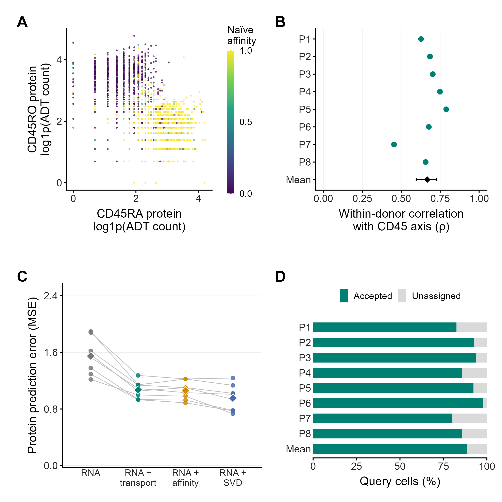

CD4 tutorial: RNA reference profiles and protein measurements
=========================================================================

Question: does an RNA-derived reference coordinate follow the measured
CD45RA/CD45RO axis across held-out donors? Read :doc:`cases` for the study findings.

1. Obtain and inspect the source
--------------------------------------------

Source accession: `GSE164378 <https://www.ncbi.nlm.nih.gov/geo/query/acc.cgi?acc=GSE164378>`_.
The retained analysis used the Hao PBMC CITE-seq 20k derivative, selected baseline
CD4 cells and retained 1,548 cells across eight donors. Counts, source annotations,
visit/donor metadata and matched antibody counts are required. The original
processed object is Seurat/RDS; convert its raw RNA and ADT counts to cell-aligned
tables/AnnData before using Python BReMAP. Do not use its normalized RNA slot as counts.
The public package does not currently distribute this conversion or the prepared cohort.

For your prepared AnnData ``data`` and ADT count table ``protein``:

.. code-block:: python

   import numpy as np

   assert data.obs_names.is_unique and protein.index.is_unique
   assert set(data.obs_names) == set(protein.index)
   protein = protein.loc[data.obs_names]
   assert (protein.to_numpy() >= 0).all()
   assert np.equal(protein.to_numpy(), np.rint(protein.to_numpy())).all()
   print(data.n_obs, data.obs["donor_id"].nunique())

Study subset output: ``1548 8``. Different preprocessing can give different totals;
check inclusion criteria rather than force an exact match by deleting cells.

2. Keep protein measurements outside the mapping inputs
-------------------------------------------------------------------

.. code-block:: python

   data = data[:, data.var_names.str.upper() != "PTPRC"].copy()
   assert "PTPRC" not in data.var_names.str.upper()
   # Use the actual measured channel names; there can be several per target.
   ra_channels = ["CD45RA"]
   ro_channels = ["CD45RO"]
   protein_axis = (np.log1p(protein[ra_channels]).mean(axis=1)
                   - np.log1p(protein[ro_channels]).mean(axis=1))

The lists above are channel-name examples. Inspect the ADT columns and explicitly
list all intended RA/RO channels. The study used mean log1p RA minus mean log1p RO;
changing ADT normalization changes the target. Preserve the cell IDs in this
separate target table. Source cell labels themselves contain multimodal information,
so excluding PTPRC does not make the entire annotation pipeline RNA-only.

3. Declare states, programs and donor roles
-------------------------------------------------------

.. code-block:: python

   import bremap as br

   spec = br.create_spec(
       spec_id="hao-cd4-protein-heldout", tissue="immune_cd4",
       states=["CD4 Naive", "CD4 TCM", "CD4 TEM"],
       programs={
           "naive": ["TCF7", "LEF1", "CCR7", "MAL", "SELL"],
           "memory": ["IL7R", "AQP3", "S100A4", "GPR183", "LTB"],
           "cytotoxic": ["NKG7", "CCL5", "GZMK", "GZMA", "CST7"],
       },
       reference_source="Hao PBMC CITE-seq GSE164378",
       eligibility="Baseline CD4; donor-disjoint roles; PTPRC excluded",
       cost_mode="biology", minimum_genes_per_anchor=3,
       heldout_validation={"protein_encoding_gene": ["PTPRC"]},
   )

For each held-out donor, the study used the next donor in sorted order for
calibration and the remaining six for reference. Restrict reference/calibration
to the declared three states; retain the documented query eligibility including
other CD4 labels. Save each fold independently. Use :doc:`case-workflow` for
input preparation, execution and output checks. Repeat for all eight query donors;
one fold is not the published eight-donor result.

4. Join mappings to protein and calculate donor correlations
------------------------------------------------------------------------

.. code-block:: python

   import pandas as pd

   cells = pd.read_csv("case_run/mapping/cells.csv")
   target = protein_axis.rename("protein_axis").rename_axis("cell_id").reset_index()
   joined = cells.merge(target, on="cell_id", validate="one_to_one")
   assert len(joined) == len(cells), "Missing protein measurements"
   coordinate = "conditional_affinity::CD4 Naive"
   donor_rows = []
   for donor, block in joined.groupby("donor_id"):
       valid = block[[coordinate, "protein_axis"]].dropna()
       donor_rows.append({
           "donor": donor, "n_scored": len(valid),
           "protein_rho": valid[coordinate].corr(valid.protein_axis, method="spearman"),
           "acceptance": block.accepted.mean(),
       })
   print(pd.DataFrame(donor_rows).to_string(index=False))

Report unavailable correlations for constant vectors/small groups. Do not silently
filter to accepted cells: that defines a different estimand. Repeat for the four
predeclared method/cost combinations. The retained study metric table can be checked by:

.. code-block:: console

   python docs/user/examples/check_case_readouts.py cd4 donor_mapping_metrics.csv

.. literalinclude:: examples/expected/cd4.txt
   :language: text

These numbers were read from the retained study results, not generated by the
synthetic quickstart. The checker summarizes existing metrics; it does not rerun
all folds or fit the protein-prediction models.

5. Interpret the visualization
------------------------------------------

Existing study visualization, not a figure generated by the tutorial runner.
Inspect donor-level concordance and coverage together. For the downstream MSE
comparison, fit prediction models with donor-held-out tuning; ``br.evaluate``
handles labels, not this continuous protein target. RNA plus direct SVD was better
than RNA plus mapped coordinates in this study; retain that comparator.
