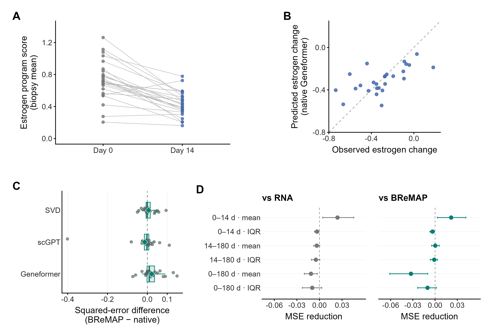

FELINE tutorial: paired changes and representation readouts
=======================================================================

1. Assemble counts and patient/visit metadata
---------------------------------------------------------

Source: `GSE211434 <https://www.ncbi.nlm.nih.gov/geo/query/acc.cgi?acc=GSE211434>`_.
The retained analysis contains 30,513 cells, 78 biopsies and 27 patients. A
cell-to-biopsy crosswalk, biopsy-to-patient crosswalk and visit labels are required.
Patient IDs, rather than biopsy IDs, define train/test separation.

.. code-block:: python

   import pandas as pd

   metadata = pd.read_csv("biopsy_metadata.csv")
   # Adapt source columns to this explicit schema before proceeding.
   assert {"biopsy_id", "patient", "day"} <= set(metadata)
   assert metadata.biopsy_id.is_unique
   assert metadata[["patient", "day"]].notna().all().all()
   print(metadata.biopsy_id.nunique(), metadata.patient.nunique())

Recorded study totals: ``78 27``. These are inclusion checks, not target numbers
for a differently filtered cohort. The prepared counts and embeddings are not
bundled with the package.

2. Map with a fixed reference and compatible representation
-----------------------------------------------------------------------

Follow :doc:`case-workflow` using the declared reference and calibration donors.
For scGPT/Geneformer, supply cell-aligned embeddings with matching provenance
across roles as described in :doc:`representations`. Counts are still required.
The package does not download or run these encoders.

In the recorded extraction, nine validation genes were withheld from encoder
inputs. Merely removing those genes from counts after computing embeddings does
not reproduce that exclusion. A different gene universe is a different experiment.

3. Construct paired biopsy summaries
------------------------------------------------

Export an explicitly defined biopsy-level score table with columns ``patient``,
``day`` and ``estrogen_mean``. Define the validation program and normalization
before comparing representations. Given this table:

.. code-block:: python

   scores = pd.read_csv("biopsy_scores.csv")
   assert not scores.duplicated(["patient", "day"]).any()
   wide = scores.pivot(index="patient", columns="day", values="estrogen_mean")
   assert {0, 14} <= set(wide.columns)
   pairs = wide[[0, 14]].dropna()
   delta = (pairs[14] - pairs[0]).rename("observed")
   print("day-0/day-14 complete pairs:", len(delta))

Recorded output: ``day-0/day-14 complete pairs: 26``. Resolve multiple biopsies
per patient/visit by a prespecified aggregation rule before pivoting. Do not treat
cells as independent patient pairs. The endpoint uses both visits; it is not a
pretreatment prediction target.

4. Evaluate out-of-fold predictions
-----------------------------------------------

For each held-out patient, fit preprocessing and the downstream regression only
on other patients; tune the regularization using inner training-patient folds.
Use identical patient folds for RNA, direct native vectors and mapped coordinates.
Keep visit/endpoint definitions fixed. BReMAP creates the mapping coordinates;
it does not implement this study's patient-level regression protocol.

Save one row per ``contrast, endpoint, model, patient`` with ``observed`` and
``prediction``. Verify the actual fitted-patient manifests separately: a tidy
prediction table cannot establish absence of leakage on its own.

.. code-block:: console

   python docs/user/examples/check_case_readouts.py feline predictions.csv

:download:`Download the readout checker <examples/check_case_readouts.py>`.
It checks uniqueness and recomputes patient-level squared errors from existing
predictions; it does not train models or reproduce missing embeddings.

Recorded output for the prespecified displayed contrast, day 0–14 estrogen mean:

.. literalinclude:: examples/expected/feline.txt
   :language: text

Smaller MSE is better. The output includes all recorded models for this contrast,
including unsuccessful variants. Other endpoints and day 0–180 must be reported
separately; selecting only the smallest MSE is not external validation.

5. Inspect the paired and comparative visualization
---------------------------------------------------------------

Retained study visualization, not regenerated by the checker. Direct Geneformer
features performed better than mapped Geneformer coordinates on the displayed
primary contrast. That result is task-specific and does not justify a general
foundation-model advantage. Look at the other five tasks and the sample size
before interpreting the gain. The figure's full downstream fitting and bootstrap
procedures are separate from this API tutorial.
