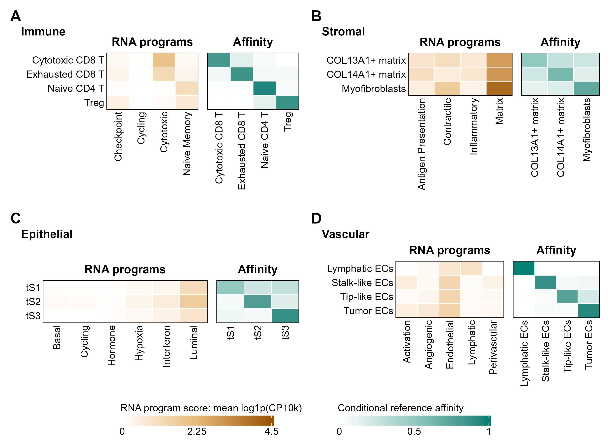

Multilineage tutorial: change the reference and programs
====================================================================

1. Choose the source and population
-----------------------------------------------

Wu breast: `GSE176078 <https://www.ncbi.nlm.nih.gov/geo/query/acc.cgi?acc=GSE176078>`_.
Kim lung: `GSE131907 <https://www.ncbi.nlm.nih.gov/geo/query/acc.cgi?acc=GSE131907>`_.
Obtain raw counts and the matching cell-label/patient crosswalk. Select immune,
stromal, epithelial or vascular cells before splitting donors. The recorded study
contains eight source/population tasks, not eight independent external cohorts.

2. Define a task-specific specification
---------------------------------------------------

For the Kim immune example:

.. code-block:: python

   import bremap as br

   spec = br.create_spec(
       spec_id="kim_immune", tissue="immune",
       states=["Cytotoxic CD8+ T", "Exhausted CD8+ T", "Naive CD4+ T", "Treg"],
       programs={
           "checkpoint": ["CTLA4", "HAVCR2", "LAG3", "PDCD1", "TIGIT", "TOX"],
           "cycling": ["BIRC5", "MKI67", "TOP2A", "UBE2C"],
           "cytotoxic": ["CTSW", "GNLY", "GZMB", "GZMH", "NKG7", "PRF1"],
           "naive_memory": ["CCR7", "IL7R", "LEF1", "LTB", "MAL", "TCF7"],
       },
       reference_source="Kim source-donor training partition",
       eligibility="Declared source labels; metadata-only donor split",
       minimum_genes_per_anchor=2, cost_mode="biology",
   )

Create separate specifications for other populations; do not apply these immune
genes to stromal cells. Use the source-specific labels and record the crosswalk.
A state vocabulary and a program list need not have the same length.

3. Prepare and run
------------------------------

Follow :doc:`case-workflow` to save ``spec.json``, prepare the three donor-disjoint
AnnData files and keep query annotations in ``annotations.csv``. Run:

.. code-block:: console

   python docs/user/examples/run_case.py --inputs case_inputs --out affinity_run --method affinity
   python docs/user/examples/check_mapping.py affinity_run/mapping
   python docs/user/examples/run_case.py --inputs case_inputs --out transport_run --method transport
   python docs/user/examples/check_mapping.py transport_run/mapping

The runner was rerun on the retained Kim immune inputs during documentation
validation. Its complete input-check output and mapping diagnostics are shown in
:doc:`case-workflow`. Exact paper replication requires the recorded selected-cell
and donor manifests, which are not yet distributed as public processed inputs.

4. Compare methods on matching cells
------------------------------------------------

.. code-block:: python

   import pandas as pd

   affinity = pd.read_csv("affinity_run/mapping/cells.csv").set_index("cell_id")
   transport = pd.read_csv("transport_run/mapping/cells.csv").set_index("cell_id")
   assert set(affinity.index) == set(transport.index)
   transport = transport.loc[affinity.index]
   assert affinity.donor_id.equals(transport.donor_id)
   for name in ["affinity_run", "transport_run"]:
       print(name)
       print(pd.read_csv(f"{name}/evaluation/summary.csv").to_string(index=False))

Do not compare Brier losses across different state vocabularies as if task
difficulty were identical. Compare coverage and hard-label F1 as well: the Kim
immune transport result improved Brier against its direct-feature comparator,
but did not improve F1. The direct-feature classifier is a separate downstream
analysis and is not fitted by ``run_workflow``.

5. Read the population profiles
-------------------------------------------

This is the retained four-population study figure. Program expression and
conditional affinity have different units and separate color scales. They show
reference-relative organization, not independent functional validation. The
sampling cap per donor/state means plotted counts are not natural cell abundances.
Wu also used supplied scGPT and Geneformer embeddings; Kim used SVD only. To change
representation, follow :doc:`representations` and keep input partitions fixed.
