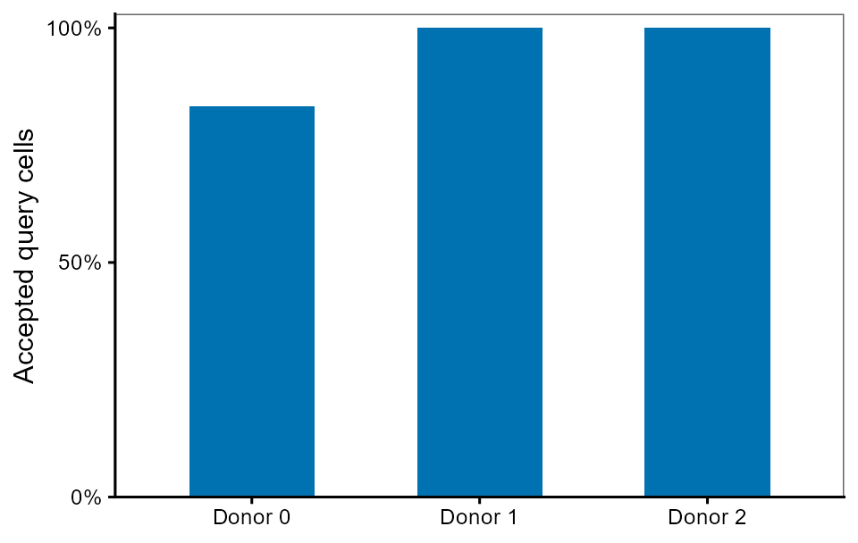
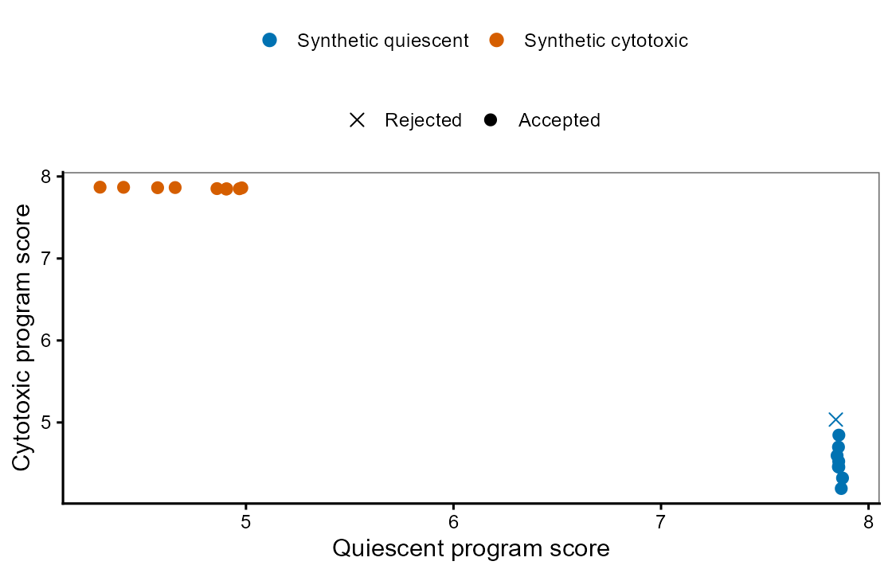

Quickstart: your first reference map
============================================================

Work through this page in one Python session or notebook: load a small example,
call BReMAP APIs, inspect the tables and interpret the plots. Every output below
was captured by executing these same code blocks; no biological data download
or foundation-model weights are needed.

Before you start
----------------

Install BReMAP following :doc:`installation`. Download these two small files into
a **new working folder**, then start Python or a notebook in that folder:

* :download:`demo_counts.csv <examples/data/demo_counts.csv>` — 54 invented cells,
  eight genes, donor IDs and development-state labels.
* :download:`demo_truth.csv <examples/data/demo_truth.csv>` — labels for the 18
  query cells, kept separate from mapping inputs.

The input is deliberately synthetic. It makes the complete tutorial reproducible
without restricted data; :doc:`cases` describes biological applications.
Output folders must not already exist. To repeat the whole tutorial, start in a
new folder containing the two downloaded CSVs.

1. Load the example counts
------------------------------------

Read the supplied CSV in a Python session. Each partition has 18 cells and three
donors; donor identities are distinct across partitions. The eight genes and two
states are synthetic, designed to make the workflow easy to inspect.

.. literalinclude:: examples/tutorial.py
   :language: python
   :start-after: # %% load
   :end-before: # %% spec

Output:

.. literalinclude:: examples/expected/tutorial_load.txt
   :language: text

2. Define what the reference should describe
------------------------------------------------------

Declare two reference states and two gene programs with ``br.create_spec``.
Replace these lists for a real task; they are not validated immune signatures.

.. literalinclude:: examples/tutorial.py
   :language: python
   :start-after: # %% spec
   :end-before: # %% prepare

Output:

.. literalinclude:: examples/expected/tutorial_spec.txt
   :language: text

3. Prepare and validate the three partitions
------------------------------------------------------

``prepare_input`` writes validated AnnData files. Query state labels are absent:
the separate truth table will be used only for evaluation. ``True`` means the
input passes the software contract, not that the reference is biologically suitable.

.. literalinclude:: examples/tutorial.py
   :language: python
   :start-after: # %% prepare
   :end-before: # %% run

Output:

.. literalinclude:: examples/expected/tutorial_prepare.txt
   :language: text

4. Run reference fitting, calibration and mapping
-----------------------------------------------------------

Call ``run_workflow`` once. It fits on reference donors, calibrates on separate
donors, maps query cells and writes program scores and a reusable reference.
The historical policy name ``normal_donor_v1`` does not restrict the task to normal tissue.

.. literalinclude:: examples/tutorial.py
   :language: python
   :start-after: # %% run
   :end-before: # %% mapping

Output:

.. literalinclude:: examples/expected/tutorial_run.txt
   :language: text

5. Inspect the mapped cells
-------------------------------------

``candidate_state`` is the closest declared state. ``accepted`` separately records
whether the cell passed the calibrated compatibility rule. A candidate label can
therefore be present even when the cell is rejected.

.. literalinclude:: examples/tutorial.py
   :language: python
   :start-after: # %% mapping
   :end-before: # %% programs

Output:

.. literalinclude:: examples/expected/tutorial_mapping.txt
   :language: text

One of the 18 cells is rejected. Keeping this distinction visible prevents
interpreting every candidate label as an accepted assignment.

6. Examine the gene-program profiles
----------------------------------------------

Read the program scores generated by BReMAP. These are mean log1p(CP10k) values
on the reference gene universe, not affinity probabilities.

.. literalinclude:: examples/tutorial.py
   :language: python
   :start-after: # %% programs
   :end-before: # %% evaluate

Output:

.. literalinclude:: examples/expected/tutorial_programs.txt
   :language: text

Each point is one query cell; color shows its candidate state, and a cross marks
rejection. The two program axes separate the invented profiles. These plots use
the exact CSV outputs above. They were rendered with native R for the documentation;
BReMAP currently returns tables and does not expose a plotting API. R is not
required to run the mapping tutorial. The optional
:download:`plotting source <examples/tutorial_plots.R>` reproduces both images
with ggplot2, ragg, systemfonts and an explicitly supplied Arial font file.

7. Check annotation agreement
---------------------------------------

The workflow evaluated the separate synthetic truth table. Show donor-macro
acceptance and macro-F1. Strong agreement is expected for this deliberately easy
example; it is not evidence of accuracy on a biological cohort.

.. literalinclude:: examples/tutorial.py
   :language: python
   :start-after: # %% evaluate
   :end-before: # %% reuse

Output:

.. literalinclude:: examples/expected/tutorial_evaluate.txt
   :language: text

8. Reuse the calibrated reference
-------------------------------------------

Import the exported reference and map the same query with ``br.map_query``.
The equality check verifies that the saved reference reproduces the original mapping.

.. literalinclude:: examples/tutorial.py
   :language: python
   :start-after: # %% reuse
   :end-before: # %% end

Output:

.. literalinclude:: examples/expected/tutorial_reuse.txt
   :language: text

What to do next
---------------

You have prepared inputs, run a complete mapping workflow, inspected scores and
acceptance, evaluated separate labels and reused a saved reference. Continue with
:doc:`own-data` to substitute your own counts, or :doc:`representations` to supply
compatible embeddings. The optional :download:`notebook-style Python source
<examples/tutorial.py>` contains the same short steps; it is not necessary to
run a separate script to use the APIs on this page.
