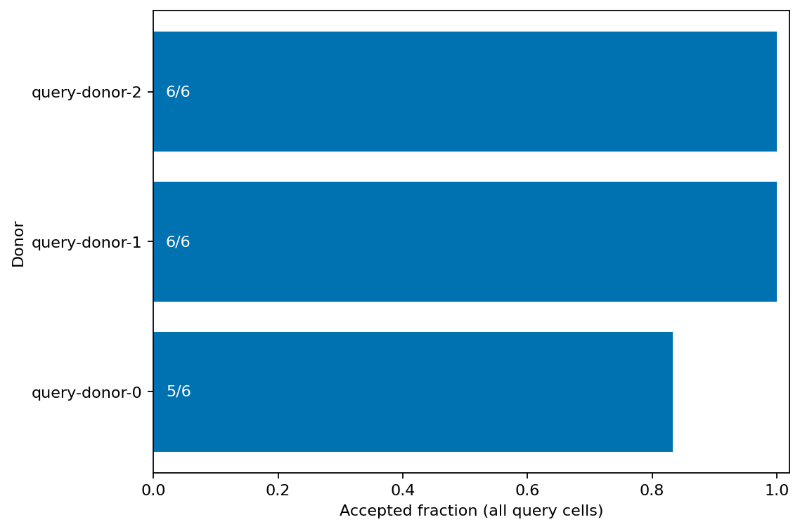
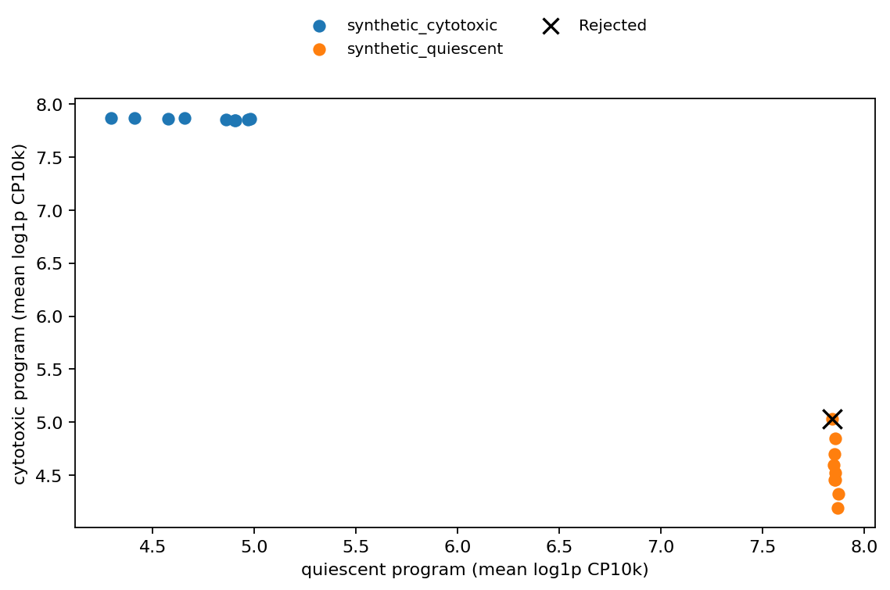
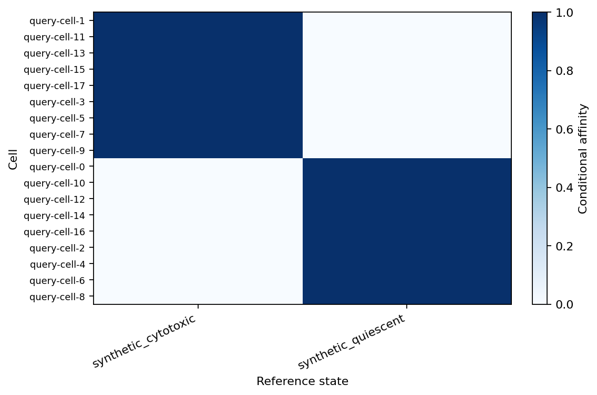
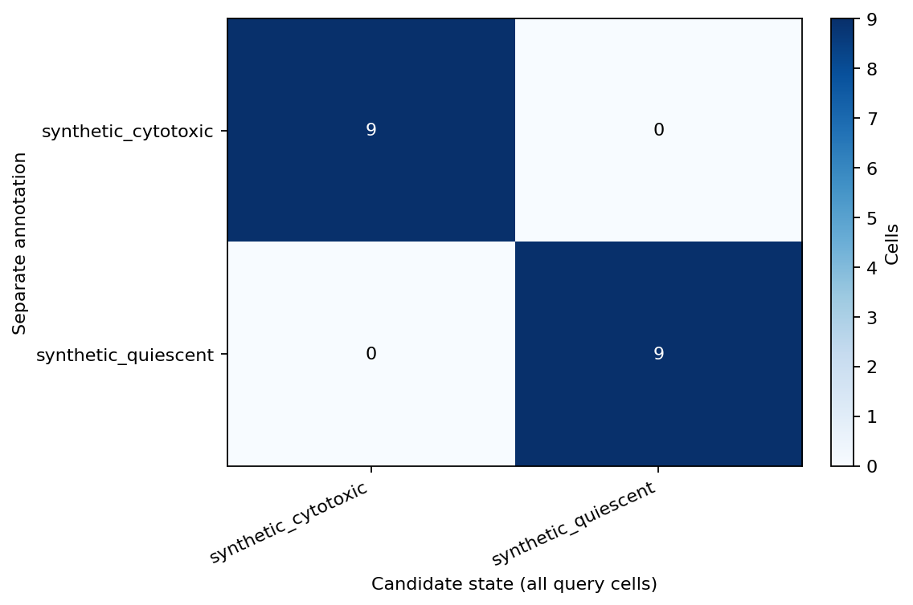

Quickstart: an API-led reference analysis
============================================================

This tutorial follows one analysis from input to interpretation. Run each short
block in the same notebook or Python session. Every output and plot below comes
from executing the displayed API calls. The plotting functions belong to BReMAP;
no pandas conversion loop, research script or R installation is needed.

Install and start
------------------------------

This tutorial requires BReMAP **0.6.2**, including its optional plotting
dependencies. From a cloned checkout of the release:

.. code-block:: console

   python -m pip install ".[plot]"

Start in a fresh working directory; input and analysis artifacts are immutable.
In a notebook the returned Figure is displayed directly. In a Python script,
``save=`` writes it to disk. All paths below are relative to that directory.

1. Load example data
--------------------------------------------------------------------------------

The package includes a small synthetic count table: 54 cells, eight genes and
three donor-disjoint roles. ``br.load_example`` returns AnnData; there is no manual
CSV conversion and no external download. ``br.describe_data`` reports each role.

.. literalinclude:: examples/tutorial.py
   :language: python
   :start-after: # %% load
   :end-before: # %% spec

Output:

.. literalinclude:: examples/expected/tutorial_load.txt
   :language: text

2. Define states and gene programs
--------------------------------------------------------------------------------

Use ``br.create_spec`` to declare the reference vocabulary and positive gene lists.
These invented profiles demonstrate software behavior, not biological validation.

.. literalinclude:: examples/tutorial.py
   :language: python
   :start-after: # %% spec
   :end-before: # %% prepare

Output:

.. literalinclude:: examples/expected/tutorial_spec.txt
   :language: text

3. Prepare and check inputs
--------------------------------------------------------------------------------

``br.prepare_partitions`` uses the roles already declared in the metadata. It
checks donor separation, validates all three inputs, and removes query state labels.
It does not choose the donor split for you. Invalid inputs leave no destination.

.. literalinclude:: examples/tutorial.py
   :language: python
   :start-after: # %% prepare
   :end-before: # %% run

Output:

.. literalinclude:: examples/expected/tutorial_prepare.txt
   :language: text

4. Run the complete analysis
--------------------------------------------------------------------------------

``br.run_analysis`` fits, calibrates, maps, scores programs and evaluates the
separate labels. It returns a ``WorkflowResult`` with table, summary and plot
methods. Labels returned by ``br.example_annotations`` are not included in query inputs.

.. literalinclude:: examples/tutorial.py
   :language: python
   :start-after: # %% run
   :end-before: # %% mapping

Output:

.. literalinclude:: examples/expected/tutorial_run.txt
   :language: text

5. Inspect assignments and coverage
--------------------------------------------------------------------------------

A candidate label is a suggestion; acceptance is a separate compatibility decision.
The bars show accepted counts over total cells for each donor. Keep both
cell-weighted and donor-macro acceptance when donor sample sizes differ.

.. literalinclude:: examples/tutorial.py
   :language: python
   :start-after: # %% mapping
   :end-before: # %% programs

Output:

.. literalinclude:: examples/expected/tutorial_mapping.txt
   :language: text

   Accepted query cells by donor; counts in each bar show the denominator.

6. Visualize gene programs
--------------------------------------------------------------------------------

Call ``result.plot`` directly from your Python notebook. Each point is a scored
query cell, colored by candidate state; a black cross identifies a rejected cell.
Program axes show mean log1p(CP10k) expression, not state probabilities.

.. literalinclude:: examples/tutorial.py
   :language: python
   :start-after: # %% programs
   :end-before: # %% affinity

Output:

.. literalinclude:: examples/expected/tutorial_programs.txt
   :language: text

   Program scores and candidate states; crosses mark rejected cells.

7. Inspect reference affinities per cell
--------------------------------------------------------------------------------

The heatmap shows conditional state affinity for each query cell, sorted by
candidate state and cell ID, including rejected cells. Missing scores remain blank.
For a donor-mean view use ``result.plot("affinity", group_by="donor_id")``. Fixed limits of zero and one support comparison within this
reference vocabulary. Affinity is not tissue composition or a malignancy probability.

.. literalinclude:: examples/tutorial.py
   :language: python
   :start-after: # %% affinity
   :end-before: # %% evaluate

   Cell-level reference affinities; candidate-state ordering makes the two profiles visible.

8. Check separate annotations
--------------------------------------------------------------------------------

The confusion plot uses candidate states for all query cells, including rejected
cells. It requires cell and donor IDs to match the separate annotation table.
The synthetic data are deliberately easy: high F1 does not validate a biological model.

.. literalinclude:: examples/tutorial.py
   :language: python
   :start-after: # %% evaluate
   :end-before: # %% reuse

Output:

.. literalinclude:: examples/expected/tutorial_evaluate.txt
   :language: text

   Separate synthetic annotations versus candidate labels, including rejected cells.

9. Reuse the calibrated reference
--------------------------------------------------------------------------------

Export is automatic in the workflow. Import the archive and map a compatible
query without fitting again. The tutorial verification also checks exact equality
between the first and reused mappings.

.. literalinclude:: examples/tutorial.py
   :language: python
   :start-after: # %% reuse
   :end-before: # %% end

Output:

.. literalinclude:: examples/expected/tutorial_reuse.txt
   :language: text

Use your own data
------------------------------

Use package loaders rather than rebuilding AnnData by hand:

.. code-block:: python

   # Raw counts in X:
   data = br.read_data("my_cells.h5ad")
   # Or explicitly use a stored raw-count layer:
   data = br.read_data("my_cells.h5ad", counts_layer="counts")
   # CSV: specify metadata; all remaining columns are gene counts.
   data = br.read_data("my_counts.csv",
                       metadata_columns=["role", "donor_id", "state"])
   print(br.describe_data(data))
   inputs = br.prepare_partitions(data, spec, "my_inputs")
   result = br.run_analysis(inputs, spec, "my_analysis")

Choose **one** loader for your format. The metadata must already contain the
reference/calibration/query roles and consistent donor IDs; the package refuses
donor overlap. CSV cell IDs are in ``cell_id`` by default. For other names, use
``cell_id=`` in ``read_data`` and ``role_column=``, ``donor_column=`` and
``label_column=`` in ``prepare_partitions``. Reference and calibration labels must
match ``spec``. Query labels may be empty and are removed during preparation.
No annotation table is required to map your own query.

Do not round normalized values to pass the raw-count check. Keep unrelated
metadata in ``metadata_columns``; otherwise it would be treated as genes.
For precomputed scGPT/Geneformer vectors, use H5AD and follow
:doc:`representations` for alignment/provenance. The loader does not compute
foundation-model embeddings.

Continue with :doc:`own-data`, :doc:`outputs` and :doc:`cases`. The complete
:download:`tutorial source <examples/tutorial.py>` is available for convenience;
every step above uses the same installed public API.
