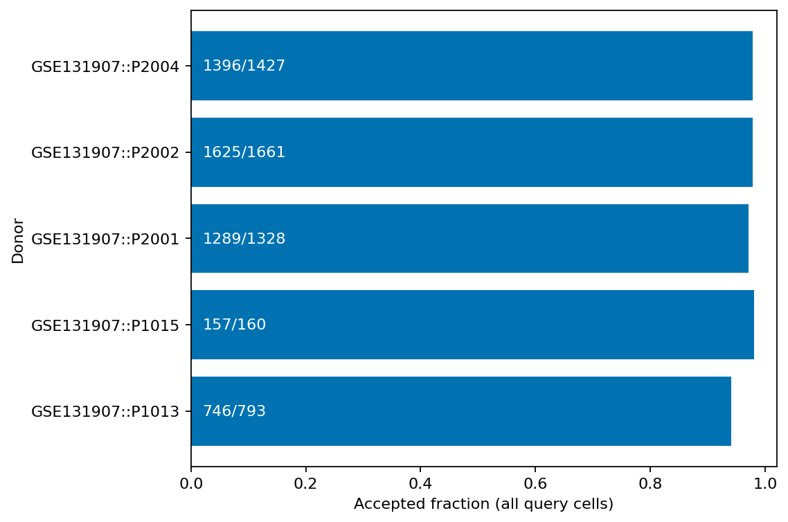
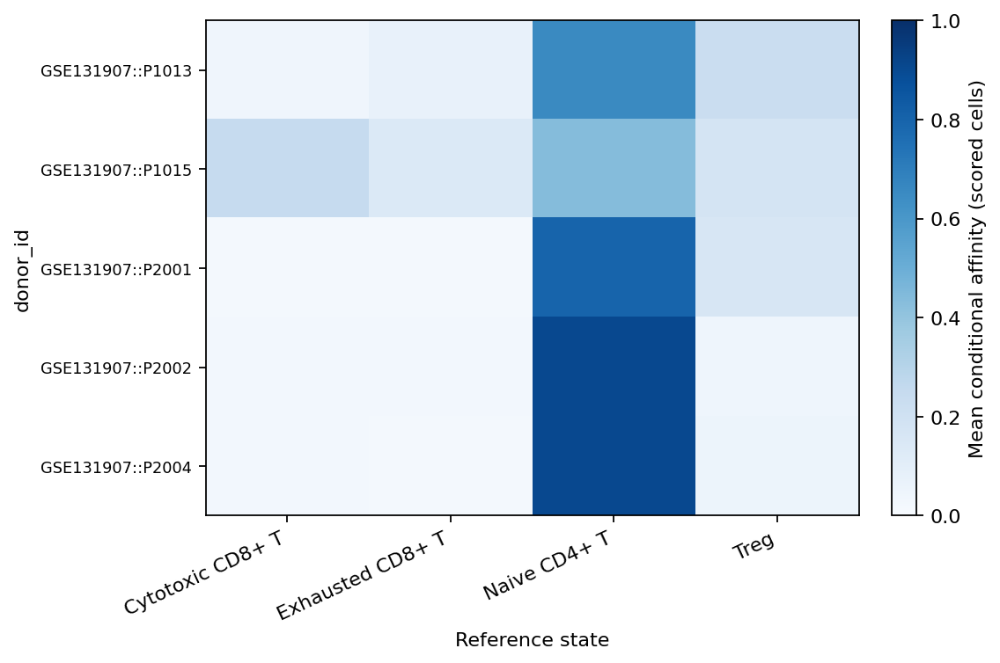

Train a student for your own T-cell mapping task
================================================

This local case demonstrates a dataset-specific student workflow. The biological
task is assigning lymph-node T cells to four annotated reference states. It does
not require the student to transfer to breast, blood or every immune population.
The generic API contracts and optional dependencies are in :doc:`distillation`.

The example uses existing GSE131907 counts and author annotations: nine development
donors contribute 1970 training/reference cells, three other donors contribute
864 validation/calibration cells, and five untouched donors contribute all 5369
eligible query cells. The query keeps its observed state frequencies. These are
within-cohort patient splits, not independent clinical validation.

Prerequisites: install ``.[train,plot]`` from the BReMAP checkout, the official
scGPT environment, and a local whole-human checkpoint. This recipe uses CUDA for
teacher extraction; student fitting and inference use CPU. The study H5AD files
and model weights are **not distributed with the package**. Provide the three
files below yourself; :doc:`quickstart` is the runnable example with bundled
synthetic data. Start in an empty working directory because outputs are immutable.

1. Read the three user-prepared count files
-------------------------------------------

.. code-block:: python

   import bremap as br

   reference = br.read_data("reference.h5ad")
   validation = br.read_data("calibration.h5ad")
   query = br.read_data("query.h5ad")

In this workspace the files are under ``outputs/revision/current/scoped_student``.
For your own study, replace these with raw-count files from disjoint donors.
Reference and calibration contain ``donor_id`` and ``state`` in ``obs``. Query
contains ``donor_id``; its state labels are kept separately for final evaluation.
Use gene-symbol ``var_names`` for BReMAP mapping. No automatic tissue or state
eligibility is inferred by the package.

2. Create development targets with an existing foundation model
---------------------------------------------------------------

.. code-block:: python

   teacher = br.TeacherEncoder(
       "scgpt", "models/scgpt/whole-human", device="cuda",
       gene_case="insensitive", max_length=1200,
       batch_size=32, chunk_size=256, seed=20261116,
   )
   training_targets = teacher.transform(reference, cache_dir="teacher/reference")
   validation_targets = teacher.transform(validation, cache_dir="teacher/calibration")

Expected table shapes for this example are ``(1970, 512)`` and ``(864, 512)``.
The checkpoint is pretrained: this step is inference, not foundation-model
training. Cached targets are specific to these cells and this encoder recipe.
Repeated calls reuse verified completed chunks. Changed inputs/configurations
require a separate cache; see the errors and identifier rules in :doc:`distillation`.

3. Train and save your student
------------------------------

.. code-block:: python

   student = br.StudentEncoder.fit(
       reference, training_targets,
       validation=validation, validation_teacher=validation_targets,
       teacher_provenance=training_targets.attrs["bremap_encoder_metadata"],
       n_genes=4096, n_components=128, hidden_size=128,
       loss="mse", epochs=40, batch_size=128, seed=20261116,
   )
   student.save("lymphnode_student.npz")

Training alone determines the genes, projection and target scaling. Validation
selects the epoch; the final five query donors do not influence these choices.
The model saved here is specific to the paired training data, not a replacement
for every capability of scGPT. An existing model file is never silently overwritten.

4. Map cells using the student through package APIs
---------------------------------------------------

.. code-block:: python

   student = br.StudentEncoder.load("lymphnode_student.npz")
   reference_s = student.attach(reference, key="X_student")
   validation_s = student.attach(validation, key="X_student")
   query_s = student.attach(query, key="X_student")

   spec = br.create_spec(
       spec_id="my-lymphnode-student", tissue="lymph_node_T_cells",
       states=["Cytotoxic CD8+ T", "Exhausted CD8+ T", "Naive CD4+ T", "Treg"],
       programs={
           "naive_memory": ["CCR7", "TCF7", "LEF1", "IL7R", "LTB", "MAL"],
           "cytotoxic": ["NKG7", "GNLY", "PRF1", "GZMB", "GZMH", "CTSW"],
           "checkpoint": ["PDCD1", "LAG3", "TIGIT", "HAVCR2", "CTLA4", "TOX"],
           "cycling": ["MKI67", "TOP2A", "UBE2C", "BIRC5"],
       },
       reference_source="Annotated lymph-node reference donors",
       eligibility="Four declared T-cell states; disjoint patient partitions",
       representation="custom", embedding_key="X_student",
       cost_mode="embedding", minimum_genes_per_anchor=2,
   )
   inputs = {
       "reference": br.prepare_input(reference_s, spec, "inputs/reference.h5ad", role="reference"),
       "calibration": br.prepare_input(validation_s, spec, "inputs/calibration.h5ad", role="calibration"),
       "query": br.prepare_input(query_s, spec, "inputs/query.h5ad", role="query"),
   }
   result = br.run_analysis(inputs, spec, "student_mapping", method="affinity")
   print(result.summary())
   print(result.table("mapping").head())

Inference now runs on CPU without importing torch. ``attach`` registers the
student's own fingerprint as a custom representation. It never labels predictions
as genuine teacher embeddings. All three partitions use the same student; a
teacher reference cannot be reused with student query coordinates.

5. Decide whether this student is useful for your task
------------------------------------------------------

For a validation study, obtain teacher query vectors only after the student recipe
is frozen. Build a separate teacher reference and compare its mappings with the
student's using ``br.evaluate_student`` and separate query annotations. Report
absolute annotation F1, coverage and per-donor errors, not just vector cosine.
Include count SVD and an appropriate RNA baseline. The thresholds in this example
are engineering choices; users should select tolerances for their own task before
the final test.

For saved teacher and student runs, no manual CSV join is needed:

.. code-block:: python

   report = br.evaluate_student(
       "teacher_mapping/mapping/cells.csv",
       "student_mapping/mapping/cells.csv",
       truth="query_labels.csv",
       states=spec.data["states"],
       agreement_threshold=0.85, maximum_coverage_change=0.05,
       maximum_f1_loss=0.05, minimum_task_f1=0.75, minimum_coverage=0.80,
   )
   print(report["agreement"], report["student_f1"], report["case_pass"])

``query_labels.csv`` has exactly the mapped cells with columns ``cell_id``,
``donor_id`` and ``label``. The teacher workflow must have been fitted separately
using teacher vectors. File paths above assume ``run_analysis`` output folders.
For the original LN test, the corresponding outputs are approximately
``0.9441, 0.7375, False``. For the frozen biopsy follow-up they are
``0.9200, 0.8170, True``. These are different query partitions, not two outcomes
of the same run. :download:`Download the saved-output evaluator
<examples/student_evaluation.py>` to check your own files using the same API.

Subsequent deployment does not require teacher inference on every query cell:
the validated student can be reused within its supported domain. Target generation
and student fitting remain upfront costs. Timing the entire workflow, including
those costs, avoids mistaking cache reuse for a faster model.

6. Inspect coverage and state profiles through package plots
------------------------------------------------------------

.. code-block:: python

   result.plot("coverage", save="student_coverage.png")
   result.plot("affinity", group_by="donor_id", save="student_affinity.png")
   result.plot("programs", x="naive_memory", y="cytotoxic",
               save="student_programs.png")

Coverage uses all query cells and shows accepted/total counts per donor. The
affinity plot uses donor means to avoid thousands of unreadable cell labels;
it is reference resemblance, not estimated tissue composition. The program plot
shows RNA scores colored by candidate state, with rejected cells marked. These
views help inspect the mapping but cannot replace task-label evaluation.

These two plots are from the original LN query (5,369 cells), whose absolute-F1
check failed; they are not plots of the later successful biopsy follow-up.

Observed results and the single follow-up
------------------------------------------------------------

The package-only tutorial was run from an installed wheel outside the repository.
After fixing target-memory-layout sensitivity, its learned parameters and all
5369 LN mapping decisions/acceptance flags matched the recorded study exactly.
The final summary was:

.. code-block:: text

   cells                       5369
   donors                         5
   accepted                    5213
   acceptance_cell_weighted    0.970944
   acceptance_donor_macro      0.969843

On this first LN test, student/teacher agreement was 94.4%, but student macro-F1
was 0.7375, below the predeclared 0.75 absolute-quality threshold. This first
case remains recorded as failing that check.

One follow-up was then declared before examining its query expression/embeddings:
all 1435 eligible T cells from four previously unused tL/B biopsy patients. The
student, reference and calibration were reused **without refitting**. Affinity
results were:

.. list-table::
   :header-rows: 1

   * - Representation
     - Donor-mean macro-F1
     - Donor-mean coverage
   * - scGPT teacher
     - 0.8488
     - 0.9689
   * - User-trained student
     - 0.8170
     - 0.9796
   * - Count SVD
     - 0.7970
     - 0.9614
   * - RNA programs
     - 0.6339
     - 0.9517

Teacher/student agreement was 92.0%; the F1 loss was 3.18 percentage points.
This follow-up passed all declared point-estimate engineering checks, including
the 90% agreement sensitivity. With four patients, it does not establish formal
noninferiority or broad transfer. The donor-bootstrap interval for student-minus-
teacher F1 was [-0.0862, 0.0044], so loss exceeding five points remains compatible
with this small sample.

The student took 1.79 s to fit/save once the 27.95 s of GPU development-target
generation was complete. Its artifact was approximately 2.3 MB. Query inference
for 1435 cells took a median 0.174 s on CPU; teacher query generation took 14.65 s
on GPU including checkpoint loading and cache work. These different timing
boundaries are not a hardware-matched speedup benchmark. This demonstrates a
usable scoped workflow, while keeping SVD and teacher inference as alternatives.

The executed source is available as ``examples/scoped_student.py``. It imports
only BReMAP for the scientific workflow; source-dataset extraction is separate.

:download:`Download the executable recipe <examples/scoped_student.py>`.
